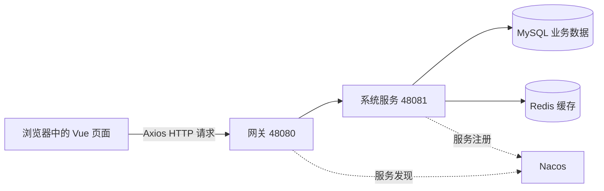
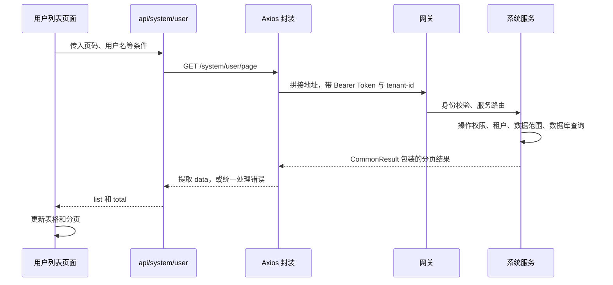
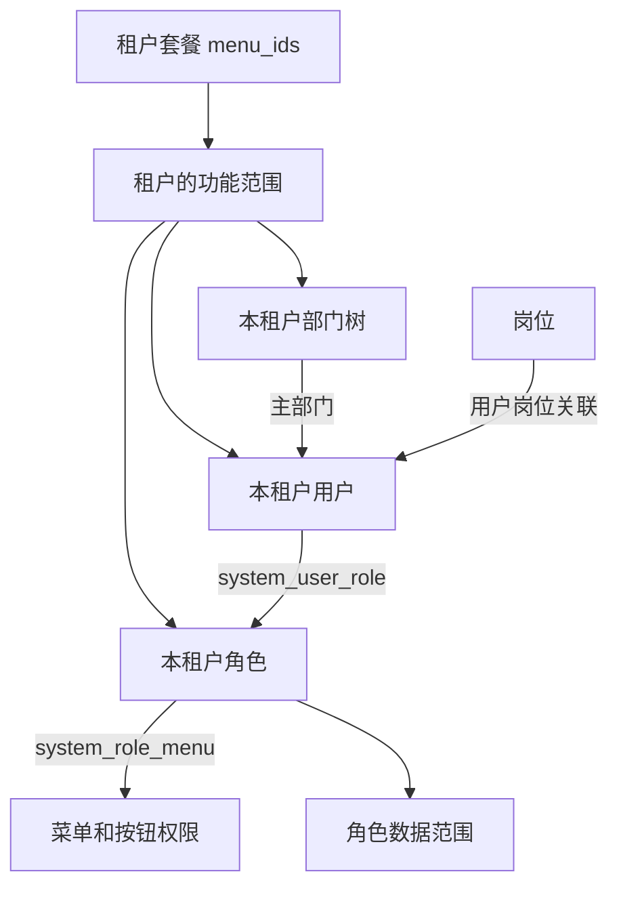
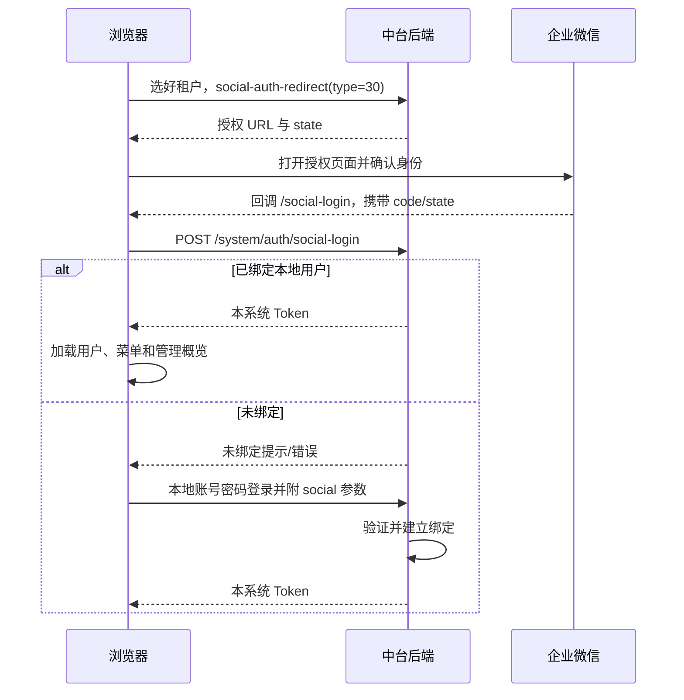

# 安天智能物流系统 · 系统中台管理前端

本仓库为 `antian-ui-admin-vue3`，本文对应 **`master-base-system`** 分支，配套后端为 `antian-cloud` 的 `master-jdk17-base-system` 分支。

这是管理员在浏览器里使用的操作界面，主要保留**管理概览、系统管理、登录、个人中心和公共组件**。租户、用户、角色、菜单、部门、岗位等数据由后端保存和校验，前端负责展示、交互和提交请求。当前不包含仓储、订单、商城、会员、工作流等业务页面。

本文面向刚开始接触项目的同学：先跑通，再理解结构，最后学习权限和业务系统接入。文中“接入示例”“后续设计”不代表已有成品功能。

## 阅读导航

- [1. 页面和后端是什么关系](#1-页面和后端是什么关系)
- [2. 技术栈与环境](#2-技术栈与环境)
- [3. 本地运行和第一次登录](#3-本地运行和第一次登录)
- [4. 目录和功能模块](#4-目录和功能模块)
- [5. 页面请求和登录调用链](#5-页面请求和登录调用链)
- [6. 路由菜单和权限](#6-路由菜单和权限)
- [7. 租户用户角色部门岗位](#7-租户用户角色部门岗位)
- [8. 怎样使用管理后台](#8-怎样使用管理后台)
- [9. 企业微信授权登录](#9-企业微信授权登录)
- [10. 新仓储业务怎样接入](#10-新仓储业务怎样接入)
- [11. 日常开发和页面修改](#11-日常开发和页面修改)
- [12. 打包与生产部署](#12-打包与生产部署)
- [13. 验收和常见问题](#13-验收和常见问题)
- [14. 新同学的学习路线](#14-新同学的学习路线)

## 1. 页面和后端是什么关系



- **Vue 页面**：例如“用户管理”的表格和编辑弹窗。
- **API 模块**：定义请求哪个地址、传哪些参数，例如 `src/api/system/user`。
- **Axios 封装**：自动带 Token 和租户，统一处理错误、续期、文件下载等。
- **Gateway**：浏览器访问后端的统一入口。
- **System 服务**：真正检查权限、处理业务和保存数据。

一个按钮的显示由前端判断；点击后能否成功，由后端再次检查。浏览器中改文字、隐藏菜单或修改 localStorage，都不能作为正式授权方式。

管理概览位于 `/index`，左侧菜单和标签文字为“管理概览”。普通登录完成后进入该页面；OAuth2 `/sso` 有独立的授权跳转流程。页面入口和里面的数据权限也要分开：能进入概览，不代表拥有所有统计接口的权限。

## 2. 技术栈与环境

以下版本来自当前 [package.json](package.json)，安装的准确版本以 [pnpm-lock.yaml](pnpm-lock.yaml) 为准。不要根据历史介绍中的 Vite 4 或 Vue Router 4 判断当前工程。

| 技术          | 当前版本/要求                          | 做什么                                         |
| ------------- | -------------------------------------- | ---------------------------------------------- |
| Node.js       | 项目要求 `>=20.19.0`；本机已有 24.12.0 | 运行开发服务器和构建工具                       |
| pnpm          | 项目要求 `>=8.6.0`；本机已使用 11.25.0 | 安装依赖，执行脚本                             |
| Vue           | 3.5.34                                 | 组件和响应式页面                               |
| Vue Router    | 5.0.6                                  | 页面地址与路由                                 |
| TypeScript    | 6.0.3                                  | JavaScript 的类型检查                          |
| Vite          | 8.1.4                                  | 本地开发和生产打包                             |
| Element Plus  | 2.13.7                                 | 表单、表格、按钮、弹窗等 UI                    |
| Pinia         | `^3.0.4`                               | 用户、权限、布局等状态管理                     |
| Axios         | 1.16.0                                 | HTTP 请求                                      |
| UnoCSS / Sass | 项目依赖管理                           | 样式工具和样式预处理                           |
| Vue I18n      | 11.4.0                                 | 多语言文案                                     |
| ECharts       | `^6.0.0`                               | 保留的通用图表依赖；不表示首页仍使用旧演示图表 |

后端主要采用 Java 17 目标、Spring Boot 3.5.15、Spring Cloud、Spring Security、MyBatis Plus、MySQL、Redis、Nacos。前端同学不必一开始掌握全部后端框架，但要知道数据库和权限不在浏览器里实现。

建议团队统一 Node 和 pnpm 版本，优先使用已验证组合。不要在同一仓库交替用 npm、yarn、pnpm 安装，避免生成不同锁文件。IDEA 用 npm 启动一个现有脚本，与用 npm 重新安装依赖是两回事。

## 3. 本地运行和第一次登录

### 3.1 确认当前分支和工具

在 PowerShell 执行：

```powershell
Set-Location D:\code\antian-ui-admin-vue3
git branch --show-current
git status --short
node --version
pnpm --version
```

当前应为 `master-base-system`。如果有自己的修改，先保存再切换；不要直接清空仓库。`pnpm` 找不到时先安装团队约定版本并重新打开终端；Node 版本过旧时先升级，不要通过随意降依赖绕过。

### 3.2 先确认后端已准备好

| 组件         | 默认本地位置                       | 是否由本仓库启动       |
| ------------ | ---------------------------------- | ---------------------- |
| 前端 Vite    | `http://localhost`，80 端口        | 是                     |
| 后端网关     | `http://localhost:48080`           | 否，在后端仓库启动     |
| 后端系统服务 | `http://127.0.0.1:48081`           | 否，在后端仓库启动     |
| MySQL        | 127.0.0.1:3306，库 `ruoyi-vue-pro` | 否，系统服务使用       |
| Redis        | 127.0.0.1:6379                     | 否，系统服务使用       |
| Nacos        | 127.0.0.1:8848，命名空间 ID `dev`  | 否，网关和系统服务使用 |

后端的 IDEA 组合运行配置是 `Antian Local`，包括 `Local System` 和 `Local Gateway`。具体数据库初始化和 Java 启动步骤见配套后端 README。

只启动前端可以看到登录页，但不会凭空生成用户或返回业务数据。当前不需要启动独立的 infra、member 等已移除服务。

### 3.3 安装依赖、启动页面

```powershell
pnpm install --frozen-lockfile
pnpm dev
```

首次下载需要网络。`--frozen-lockfile` 保证按提交的依赖版本安装；如果提示锁文件不兼容，先核对 pnpm 版本和项目变更，正常开发不应随手删除锁文件。

启动后看终端显示的实际地址，默认访问 `http://localhost`。默认端口来自 `.env` 的 `VITE_PORT=80`。如果被占用，可在当前终端临时指定一个空闲端口：

```powershell
$env:VITE_PORT = '3000'
$env:VITE_OPEN = 'false'
pnpm dev
```

此时访问 `http://localhost:3000`。端口变化会改变浏览器 origin，因此原端口的 localStorage 登录状态不共享，需要重新登录。终端停止服务使用 `Ctrl+C`。

### 3.4 在 IntelliJ IDEA 2025.3.1 中启动

1. 打开前端仓库目录，检查 JavaScript/TypeScript、Vue 和 Node.js 相关支持可用。
2. 在终端执行一次 `pnpm install --frozen-lockfile`，等待完成。
3. 使用共享配置 **`Antian Frontend Local`**。它执行 `package.json` 的 `dev` 脚本，并设置 API 为 `http://127.0.0.1:48080`、不自动打开浏览器。
4. 如果配置未出现，手动创建 npm 类型运行配置：Package JSON 选择本仓库，Command 为 `run`，Scripts 为 `dev`，Node interpreter 选择自己的 Node 20.19+。
5. 本机共享配置写有 `C:/Program Files/nodejs/node.exe`；其他电脑安装位置不同需调整。

该 IDEA 配置用 npm **执行脚本**，依赖仍建议用 pnpm 安装。也可以直接在 IDEA 终端执行 `pnpm dev`，效果一致。IDEA 的 Environment variables 会覆盖 `.env` 文件中的同名配置，排障时要一起检查。

### 3.5 核对环境变量

| 配置                                                  | 当前用途                               |
| ----------------------------------------------------- | -------------------------------------- |
| `.env`                                                | 公共默认值：标题、端口、租户开关等     |
| `.env.local`                                          | 当前本地 API 地址、本地验证码等设置    |
| `.env.dev` / `.env.test` / `.env.stage` / `.env.prod` | 对应脚本模式的设置，以实际存在文件为准 |
| `vite.config.ts`                                      | Vite 的端口、插件、别名、构建输出等    |
| `src/config/axios/config.ts`                          | 拼接最终 API 基础地址                  |

本地主要值：

```dotenv
VITE_APP_TITLE=安天智能物流系统
VITE_PORT=80
VITE_BASE_URL=http://localhost:48080
VITE_API_URL=/admin-api
VITE_BASE_PATH=/
VITE_APP_TENANT_ENABLE=true
VITE_APP_CAPTCHA_ENABLE=false
```

最终 API 地址为 **`VITE_BASE_URL + VITE_API_URL + 接口相对路径`**。例如用户分页就是 `http://localhost:48080/admin-api/system/user/page`。API 文件里不要再重复写一遍 `/admin-api`。

Vite 会读取公共 `.env`、`.env.local` 和当前模式配置，模式文件可覆盖公共值；启动进程已有的环境变量优先级更高。**`.env.local` 也可能影响生产构建**，不能理解为只在 `pnpm dev` 下使用。生产必须显式核对验证码、默认账号、API 地址等最终值。

`dev` 脚本当前使用 `vite --mode env.local`，是仓库已有约定；不要自行改成 `--mode local`。环境变量通常在启动/打包时读取，改后需重启 Vite；生产已经生成的 JS 不会因服务器上改了 `.env` 自动变化。

所有 `VITE_*` 值都可能进入浏览器代码，**不能存数据库密码、企微 Secret、OAuth2 clientSecret 等后端秘密**。当前 `.gitignore` 没有通用忽略 `.env.*.local` 的规则，新增本机覆盖文件前应检查 Git 状态，不能假定它不会提交。

### 3.6 使用哪个账号登录

登录页第一栏是**租户名称**，不是用户所属部门。必须与后端数据库一致。

| 数据库来源                      | 租户名                            | 用户名和密码                                              |
| ------------------------------- | --------------------------------- | --------------------------------------------------------- |
| 先前配置好的本机环境            | 通常为 `安天集团`，平台租户 ID 1  | 使用该环境实际账号；原本地演示管理员是 `admin / admin123` |
| 后端 `init-system.sql` 新建空库 | 当前种子仍叫 **`安天源码`**，ID 1 | 种子管理员 `admin / admin123`                             |
| 新创建的普通租户                | 创建时填写的租户名称              | 创建时设置的管理员账号密码                                |

前端默认租户名是“安天集团”，不会改写数据库。全新种子库先在表单中填写“安天源码”，登录后通过有权限的管理功能维护名称，再同步前端默认值。生产不要使用演示密码。

`superAdmin`、`super` 都只是账号名，不代表一定拥有超级管理员角色，也不能推测它们的密码。账号不存在或密码不清楚，应由有权限的管理员创建/重置，不要在前端代码里绕过登录。

“记住我”缓存租户名、用户名和勾选状态，当前实现不保存明文密码。开发默认密码填充与记住我不是同一件事。

## 4. 目录和功能模块

前端没有 Java Maven 那样的多个可执行 module。下面按页面、数据和公共能力分组，整个仓库通常打包成一套静态站点。

### 4.1 顶层结构

```text
antian-ui-admin-vue3/
├─ src/
│  ├─ views/            页面：system、Home、Login、Profile 等
│  ├─ api/              与后端交互的请求函数
│  ├─ router/           静态路由和路由创建
│  ├─ permission.ts     全局导航守卫
│  ├─ store/            Pinia 用户、权限、布局等状态
│  ├─ layout/           顶栏、侧栏、标签页和主体布局
│  ├─ components/       可复用组件，如表格、上传、品牌标识
│  ├─ config/axios/     统一 HTTP 请求处理
│  ├─ directives/       权限等自定义指令
│  ├─ hooks/            可复用逻辑与缓存工具
│  ├─ utils/            路由、认证、三方回调等工具
│  ├─ locales/          中文、英文等文案
│  ├─ assets/           图片、图标等素材
│  ├─ styles/           全局与主题样式
│  ├─ types/            TypeScript 类型
│  └─ plugins/          插件注册
├─ public/              原样复制到站点的静态文件
├─ build/               Vite 插件与构建辅助
├─ index.html           页面入口及首次加载界面
├─ vite.config.ts       Vite 配置
├─ package.json         依赖、开发和构建脚本
├─ pnpm-lock.yaml       锁定依赖版本
└─ .env*                不同环境的配置
```

`@/` 是 `src/` 的别名。例如 `@/api/system/user` 指向 `src/api/system/user`。页面在 `views`，接口函数在 `api`，不要把数据库连接写进 Vue 文件。

### 4.2 页面模块

| 目录                 | 用途                                                            |
| -------------------- | --------------------------------------------------------------- |
| `src/views/Home`     | 管理概览、组织成员分布、账号及权限活动统计                      |
| `src/views/Login`    | 密码/短信/二维码等登录、注册、找回密码、三方回调和 SSO 授权交互 |
| `src/views/Profile`  | 当前用户资料、密码和社交账号绑定等                              |
| `src/views/system`   | 下表中的系统管理功能                                            |
| `src/views/Error`    | 403、404、500 等错误页                                          |
| `src/views/Redirect` | 路由刷新跳转辅助                                                |
| `src/views/IFrame`   | 公共嵌入页面容器；不代表任意外部页面已经安全接通                |

### 4.3 系统管理功能

| `src/views/system` 下的目录 | 管理内容                               | 对应的主要数据                    |
| --------------------------- | -------------------------------------- | --------------------------------- |
| `tenant`                    | 租户列表、详情、新增和编辑             | `system_tenant`                   |
| `tenantPackage`             | 套餐和功能范围                         | `system_tenant_package`           |
| `user`                      | 用户增删改查、导入导出、分配角色       | `system_users`、用户角色/岗位关联 |
| `role`                      | 角色、菜单授权和数据权限               | `system_role`、`system_role_menu` |
| `menu`                      | 目录、页面和按钮权限点                 | `system_menu`                     |
| `dept`                      | 部门组织树                             | `system_dept`                     |
| `post`                      | 岗位                                   | `system_post`                     |
| `dict`                      | 字典类型和字典数据                     | `system_dict_type/data`           |
| `notice` / `notify`         | 公告、站内信和模板等                   | 公告、通知相关表                  |
| `sms` / `mail`              | 短信/邮件渠道、模板和记录              | 对应渠道、模板、日志表            |
| `loginlog` / `operatelog`   | 登录与业务操作记录                     | `system_login_log/operate_log`    |
| `oauth2`                    | 外部系统客户端、授权和令牌管理相关页面 | OAuth2 相关表                     |
| `social`                    | 第三方应用、身份相关管理               | `system_social_*`                 |
| `area`                      | 地区等基础数据页面                     | 后端地区能力                      |

请求函数基本位于同名 `src/api/system/*` 下；权限分配另有 `src/api/system/permission`，概览在 `src/api/system/dashboard`。文件通用接口放在 `src/api/system/support/file`，仍调用 `/infra/file/...` 兼容路径，不需要恢复已删除的基础设施业务模块。

页面代码保留不等于当前角色能看到所有目录，实际菜单由后端授权和本分支的过滤决定。

## 5. 页面请求和登录调用链

### 5.1 点击“查询用户”之后发生什么



API 文件应只表达“请求什么”，页面管理“何时请求与如何显示”，认证头、刷新令牌、统一错误提示交给 `src/config/axios/service.ts`。

### 5.2 登录流程

1. 页面根据租户名或绑定域名获取 tenantId，保存到浏览器缓存。
2. `LoginForm.vue` 提交账号、密码和需要的验证码，调用 `/system/auth/login`。
3. 后端校验租户、账号、密码和状态，返回本系统 Access Token、Refresh Token 等。
4. `src/utils/auth.ts` 保存令牌，导航守卫读取用户和权限信息。
5. 用户状态写入 Pinia 与缓存，权限状态根据后端菜单生成动态路由。
6. 将动态路由加入 Vue Router，普通登录进入 `/index`“管理概览”。

浏览器刷新后，Pinia 内存会重新建立，因此守卫需要结合 Token、缓存和后端权限重新准备路由。不要为了修刷新问题把所有业务页都放进免登录白名单。

### 5.3 Token 与缓存在哪

| 本地缓存 key    | 保存内容                                 |
| --------------- | ---------------------------------------- |
| `ACCESS_TOKEN`  | 当前访问令牌                             |
| `REFRESH_TOKEN` | 刷新令牌                                 |
| `tenantId`      | 原始登录租户 ID                          |
| `visitTenantId` | 受控访问租户上下文，若使用了切换         |
| `user`          | 用户信息与权限缓存                       |
| `roleRouters`   | 后端提供的菜单路由数据                   |
| `loginForm`     | 记住的租户名、账号和勾选状态，不保存密码 |

默认使用 localStorage，代码入口为 `src/hooks/web/useCache.ts` 和 `src/utils/auth.ts`。缓存库有自己的对象/有效期封装，开发者工具里看到的值不一定是裸 Token 字符串，业务代码应调用 `getAccessToken()` 等工具读取。

后端长期记录在 `system_oauth2_access_token`、`system_oauth2_refresh_token`，并使用 Redis 访问令牌缓存。当前 Token 是随机不透明字符串，不是 JWT，不应在浏览器尝试解码出用户或租户后自作授权。

### 5.4 每个请求带什么

```http
Authorization: Bearer <access_token>
tenant-id: <登录租户ID>
```

启用租户模式时 Axios 自动添加 `tenant-id`；有访问租户上下文时，受控请求还可带 `visit-tenant-id`。部分接口会通过 `isVisitTenant=false` 等内部配置避免套用访问租户。

修改请求头不等于取得权限：后端会比较原始登录身份和目标租户。Gateway 清理外部伪造的内部头，校验 Token 后传递可信身份；后端服务内部 Feign 主要传登录身份和租户上下文，不是每个子系统自行复制 localStorage。

当前 `withCredentials=false`，主要认证方式是 Bearer Token，不是依赖浏览器跨域 Cookie 登录。浏览器 origin 不同，localStorage 不共享；独立业务域名应走单点登录设计。

### 5.5 令牌过期、业务错误和响应数据

- 后端通常返回 `{ code: 0, msg: '', data: ... }`，前端兼容成功码 0 和 200。
- `request.get/post/put/delete` 通常返回已提取的 `data`，页面不要习惯性再套两层 `.data.data`。
- 二进制导出、上传、`postOriginal` 有各自处理方式，按现有同类调用写。
- 业务 `code=401` 时，Axios 尝试用 Refresh Token 续期；同时发出的请求排队，成功后回放。
- 续期失败时进入重新登录流程，清除令牌和用户路由缓存。
- `code=403` 表示无权限，不是让前端无限刷新 Token 可以解决。

HTTP 200 不等于业务成功。浏览器 Network 要同时检查请求 URL、请求头和 Response 中的 code。

项目保留了 API 加解密封装，但不是所有请求都自动加密：请求还需显式的 `isEncrypt` 配置，响应则按约定头判断。前后端算法、开关和密钥配置必须一致；前端可见密钥不能代替 HTTPS 或服务端权限。

## 6. 路由菜单和权限

### 6.1 静态路由和动态路由

| 类型         | 来源                                              | 例子                                              |
| ------------ | ------------------------------------------------- | ------------------------------------------------- |
| 静态公共路由 | `src/router/modules/remaining.ts`                 | 管理概览、登录、SSO、个人中心、我的站内信、错误页 |
| 动态业务路由 | 后端菜单 → 用户缓存 → permission store → 路由转换 | 系统管理下的租户、用户、角色等                    |
| 导航守卫     | `src/permission.ts`                               | 未登录跳登录页，登录后加载用户和菜单              |

当前 Router 使用 history 模式，不带 `#`，生产必须配置 Nginx 回退到 `index.html`。`src/utils/routerHelper.ts` 将后端组件名映射为实际 Vue 页面，因此菜单里的组件路径必须与代码对应。

### 6.2 精简分支为什么只显示系统管理

后端 `antian.system-only=true` 与 `MenuServiceImpl` 保留系统根菜单；前端 [src/store/modules/permission.ts](src/store/modules/permission.ts) 再筛选路径为 `system` 的动态根路由。管理概览由静态路由保留在左侧导航。

旧数据库中可能还有其他业务菜单，但它们不应在此分支显示。只在数据库新增一个 WMS 根菜单，目前仍会被过滤；必须按第 10 节同时调整双端范围并补齐代码。

### 6.3 菜单权限与按钮权限

菜单定义三种东西：目录分组、页面入口、按钮权限点。角色授予这些菜单/按钮，用户通过角色获得权限字符串。

```vue
<el-button v-hasPermi="['system:user:create']" @click="openCreateForm">
  新增用户
</el-button>
```

上面指令用于 UI 判断，后端仍必须检查同名权限。需要在脚本中判断时，可参考 `src/directives/permission/hasPermi.ts` 的 `hasPermission` 和现有页面写法，不要根据昵称或用户名猜权限。

角色变更后，已经打开的页面和缓存菜单可能还未更新。重新登录获取最新菜单再核对；这不代表要清空所有 localStorage 或删除其他用户数据。

### 6.4 四类权限不要混淆

| 概念     | 作用                             | 谁最终检查                 |
| -------- | -------------------------------- | -------------------------- |
| 登录认证 | 确定当前用户是谁                 | 后端安全过滤器             |
| 功能权限 | 能否查询、新增、编辑、删除某资源 | 后端接口；前端同步控制显示 |
| 租户隔离 | 不能跨公司空间读取数据           | 后端租户上下文与查询规则   |
| 数据范围 | 同一租户内只看本人、本部门等     | 后端数据权限及业务校验     |

角色数据范围包括全部、指定部门、本部门、本部门及下级、本人。“全部”通常仍是当前租户内的全部，不是全平台所有租户。

新业务表需要后端主动注册数据规则或实现归属检查。前端传一个 `deptId` 查询条件不是安全的数据权限，因为请求参数可以被修改。

### 6.5 平台租户管理的现行边界

| 操作                                          | 需要什么                                                                |
| --------------------------------------------- | ----------------------------------------------------------------------- |
| 租户列表、详情                                | 原始登录租户 ID 1，后台用户，`system:tenant:query`                      |
| 新增/编辑/删除/导出                           | 同样的平台身份，加对应 `system:tenant:create/update/delete/export` 权限 |
| 套餐下拉 `/system/tenant-package/simple-list` | 平台身份和租户查询权限，用于租户页面显示/选择套餐名称                   |
| 完整套餐管理                                  | 平台超级管理员角色 `super_admin` 加对应套餐权限                         |

因此 `superAdmin` 不必分配全业务超级角色，只要在平台租户中获得相应系统管理权限即可完成获准的租户操作。账号叫 `superAdmin` 与角色标识 `super_admin` 完全不同。

`package_id=0` 的内置系统租户可以改基本信息；套餐、账号额度、到期时间、状态受保护，不能删除。界面控制和后端保护需要一致，不能靠前端改 payload 绕过。

## 7. 租户用户角色部门岗位

### 7.1 初学者可以这样记

| 对象 | 解释                           | 例子               |
| ---- | ------------------------------ | ------------------ |
| 租户 | 独立客户/组织的数据空间        | 安天物流           |
| 套餐 | 平台允许这个租户使用的功能上限 | 系统管理套餐       |
| 部门 | 租户内部组织树                 | 总部 → 仓储部      |
| 岗位 | 人员的组织职位                 | 仓管员             |
| 用户 | 实际登录账号                   | zhangsan           |
| 角色 | 一组操作权限与数据范围         | 仓储查询员         |
| 菜单 | 目录、页面或按钮权限点         | 用户管理、用户新增 |

用户属于一个租户，有一个主部门，可关联多个岗位和多个角色。岗位不直接授予接口权限。部门是组织关系，角色是授权关系，不能简单互相替代。

### 7.2 后端数据关系



核心表是 `system_tenant`、`system_tenant_package`、`system_users`、`system_dept`、`system_post`、`system_role`、`system_menu`，关联通过 `system_user_role`、`system_role_menu`、`system_user_post` 等维护。

前端显示这些表对应的业务 VO，而不是直接查数据库。修改接口应交给后端维护关联和事务，不能用页面里多个任意请求拼成一个没有一致性保障的“完整创建”。

### 7.3 三个常见误解

- 把部门名称改成“安天集团”，不会把这个部门变成平台租户；平台租户身份依据原始 tenantId=1。
- 把用户昵称改成“超级管理员”，不会获得超级角色；权限来自实际角色关联。
- 把岗位设成“部门主管”，不会自动获得部门所有数据；还需要角色数据范围和后端规则支持。

## 8. 怎样使用管理后台

### 8.1 第一次配置组织和人员

1. 登录到正确租户，进入管理概览核对统计。
2. 在部门管理建立组织树，再在岗位管理建立职位。
3. 在角色管理建立业务角色，分配页面和按钮权限，并选择数据范围。
4. 在用户管理创建人员，指定主部门和岗位。
5. 在用户列表的“分配角色”中关联角色。
6. 用该普通账号重新登录，实际验证菜单、按钮和数据。
7. 平台如需服务新客户，先配置套餐，再通过租户创建流程生成新租户及管理员。

### 8.2 管理概览里每一块是什么

当前首页不再使用旧“项目卡片、访问来源饼图、每周活跃演示图”，而是组织和账号管理视图。

| 区域               | 数据或行为                                         |
| ------------------ | -------------------------------------------------- |
| 顶部指标           | 子公司、启用人员、启用部门、角色、未分配角色人员   |
| 账号与角色权限统计 | 日期和关键字筛选，账号开通、停用、权限变更及明细   |
| 组织架构           | 主组织及独立组织、部门和成员分布                   |
| 成员明细           | 当前可见成员、角色；有授权时可进入角色分配         |
| 系统入口           | 当前系统分支的可用入口；不表示仓储等外部系统已接入 |

数据来自：

- `GET /system/dashboard/overview`：需要用户、部门、角色三个查询权限。
- `GET /system/dashboard/activity`：需要用户、角色查询和 `system:operate-log:query`。

“子公司”按主组织直属子节点数统计，不是平台租户总数。账号开通按用户创建时间，停用和角色权限变动依赖后端已记录的操作日志，不能据此宣称统计了所有业务系统活动。活动系统筛选目前只接入统一用户中心。

某块显示无权限时，应检查该块的具体接口权限，不要把它当作零数据，也不要自动赋予当前账号所有权限。

### 8.3 如何处理一次权限问题

1. 在浏览器 Network 找到失败 URL，查看 `code` 和 `msg`。
2. 确认登录的是哪个租户，是否处于访问租户上下文。
3. 管理员核对用户实际角色、角色菜单与按钮、套餐范围。
4. 若只是数据少，核对角色数据范围和筛选条件。
5. 变更后重新登录测试，确认后端也按预期拒绝未授权请求。

不要把“全部菜单可见”作为修复单个编辑权限的办法。角色应该按工作职责授权。

## 9. 企业微信授权登录

### 9.1 当前已有的前端和后端能力

登录页已提供“企业微信授权”图标，位于其他登录方式中，定义在 `src/views/Login/components/LoginForm.vue`，类型值为 **30**，图标标识 `svg-icon:wecom`。

当前实现是：前端申请跳转地址，企业微信回调到前端，前端把 code/state 交给后端；后端 JustAuth 取得三方身份，根据绑定关系登录本地用户。**图标出现不等于企业应用已经配置成功，也不等于实现了企微通讯录同步和自动授权。**

### 9.2 一次授权登录的步骤



`SocialLogin.vue` 会先尝试已绑定登录；未成功时保留本地账号密码绑定路径。具体失败原因仍应检查响应，不应把所有授权失败都判断为“账号不存在”。

### 9.3 关键代码与配置

| 文件或接口                                        | 作用                                                     |
| ------------------------------------------------- | -------------------------------------------------------- |
| `src/views/Login/components/LoginForm.vue`        | 社交授权入口、选租户、构造回调目标                       |
| `src/views/Login/SocialLogin.vue`                 | 处理回调、尝试登录、绑定流程                             |
| `src/utils/social.ts`                             | 回调 URL 编码、提取 code/state、兼容路由形式、清理地址栏 |
| `src/api/login/index.ts`                          | 调用三方授权及登录接口                                   |
| `src/views/Profile`                               | 个人中心相关社交绑定交互                                 |
| `GET /admin-api/system/auth/social-auth-redirect` | 后端生成授权 URL                                         |
| `POST /admin-api/system/auth/social-login`        | 后端用三方回调登录                                       |

不要随意把回调工具替换成简单字符串拼接；当前实现处理了回调参数整体编码、history/hash 兼容及重复使用授权码的问题。提取授权参数后会清理地址栏中的 code/state 等参数，保留必要跳转信息。

后端的配置先来自 `justauth.type.WECHAT_ENTERPRISE`，再由当前租户下启用的 `system_social_client` 记录覆盖应用凭证。应用 Secret 必须只在后端保存；前端不直接向企微换成员身份。

官方配置参考：[扫码授权链接](https://developer.work.weixin.qq.com/document/path/91039)、[网页授权链接](https://developer.work.weixin.qq.com/document/path/91022)、[取得访问用户身份](https://developer.work.weixin.qq.com/document/path/91023)。域名验证、回调域名、应用可见范围与网络设置以当前官方说明和企业后台为准。本文基于代码说明链路，不代表已替每个企业完成联调。

### 9.4 后续打算如何设计，尚未完成

- 后端维护 CorpID、应用与租户的可信映射，不接受任意 tenantId 作为身份来源。
- 三方身份以企业维度加稳定成员标识关联本地 userId；不凭昵称或相同手机号直接合并账号。
- 如果要自动开户，首次仅分配受限角色或进入审核，不能自动变成平台管理员。
- 通讯录同步单独建设：组织映射、增量同步、幂等、重试和失败告警。
- 离职需要停用本地账号并撤销有效会话；企微组织和本地角色的映射需要明确配置。
- 前端增加“待绑定、待审批、应用不可用、授权取消”等明确状态，不把所有失败都显示为账号密码错误。
- 区分企微确认身份与本地授权；登录成功仍受本系统角色、租户和数据范围限制。

前端不能实现这些后端能力的替代品；只有增加一个图标或一个同步按钮，不算完成企业身份集成。

## 10. 新仓储业务怎样接入

以下是新增 WMS 的接入示例，**当前仓库没有这些页面或接口**。先决定是共享中台后台，还是独立系统只接单点登录。

### 10.1 方式一：在本后台增加仓储模块

建议新增：

```text
src/api/wms/stock/index.ts        库存接口
src/api/wms/receipt/index.ts      入库单接口
src/views/wms/stock/index.vue     库存页面
src/views/wms/receipt/index.vue   入库单页面
```

开发流程：

1. 后端增加 WMS 服务及数据库迁移，注册 Nacos，并在 Gateway 配置 `/admin-api/wms/**` 路由。
2. 前端在 `src/api/wms` 定义接口类型和请求函数，继续使用现有 request 封装。
3. 在 `src/views/wms` 实现页面和表单，配置唯一组件名，避免缓存页面串用。
4. 系统菜单中创建 WMS 根目录、页面和按钮权限，例如 `wms:stock:query`。
5. 后端 `MenuServiceImpl` 和前端 `src/store/modules/permission.ts` 都扩展为允许 `system`、`wms`。不要直接删除过滤使历史所有业务菜单复活。
6. 平台套餐加入所需菜单，租户角色再分配到用户。
7. 在需要的位置加入入口；管理概览中的系统活动统计另行开发，不会自动统计 WMS。
8. 用查询角色、操作角色、不同部门和不同租户验证接口与数据隔离。

API 示例：

```typescript
// 接入示例，需要后端先实现接口
import request from "@/config/axios";

export interface StockPageQuery {
  pageNo: number;
  pageSize: number;
  skuCode?: string;
}

export const getStockPage = (params: StockPageQuery) =>
  request.get({ url: "/wms/stock/page", params });
```

按钮使用相同权限字符串，例如 `v-hasPermi="['wms:stock:query']"`；后端接口仍要添加检查。库存表的租户、部门、仓库、货主范围在后端实现，不能只靠前端隐藏下拉选项。

### 10.2 方式二：独立仓储前后端接入 SSO

独立系统通常有自己的域名和发布节奏，不共享本页面 localStorage。当前保留 `/sso` 授权页和 OAuth2 客户端接口，作为接入基础：

1. 平台管理员为仓储注册独立 OAuth2 客户端、允许的回调地址和范围。
2. 仓储后端生成 state，浏览器跳到中台 `/sso`。
3. 用户登录并授权，中台携带授权码回到仓储后端回调。
4. **仓储后端**校验 state、携带客户端凭证换 Token，再获取用户身份并建立自己的会话。
5. 仓储系统按中台租户和用户标识执行自己的业务权限，并设计刷新、退出和禁用账号后的处理。

跳转地址示例：

```text
https://platform.example.com/sso?client_id=wms&response_type=code&redirect_uri=https%3A%2F%2Fwms.example.com%2Fauth%2Fcallback&scope=user.read&state=<随机值>
```

前端授权组件位于 `src/views/Login/components/SSOLogin.vue`，接口封装在 `src/api/login/oauth2/index.ts`。后端提供 `/system/oauth2/authorize`、`/system/oauth2/token`、`/system/oauth2/check-token` 和 `/system/oauth2/user/get` 等；Token/校验接口的客户端认证方式及参数详见后端 README。

不要把 `clientSecret` 放到独立 SPA 的 `VITE_*` 里，也不要把中台管理 Token 直接拼进业务系统 URL。当前实现不是完整 OIDC/PKCE/单点登出成品；纯前端公网客户端等场景需要先补齐合适的协议能力和安全设计，再接入。

### 10.3 企微登录与子系统单点登录不是一回事

企微登录解决“中台如何确认这个人的身份”；OAuth2 SSO 解决“仓储系统如何通过中台获得受控身份”。中台完成企微登录后，可以再走 SSO 给仓储授权，但企微 code、中台 Token、仓储会话三者不可互换。

## 11. 日常开发和页面修改

### 11.1 最小页面开发步骤

1. 先与后端确认 URL、HTTP 方法、参数、响应类型、权限字符串和错误码。
2. 在对应 `src/api` 模块写 TypeScript 类型和请求函数。
3. 在 `src/views` 写页面，明确加载中、空数据、请求失败和无权限状态。
4. 接入已有表格、分页、字典、弹窗、上传等公共组件，参考同类系统页面。
5. 配好后端菜单组件路径和权限，获取新菜单后再访问页面。
6. 测试查询条件、分页、表单校验、重复点击、导出和不同权限账号。

例如 API 已返回 `data` 时，页面拿到的是实际对象，不需要再次读取 `res.data.data`。修改表单后不要直接修改表格共享对象，避免取消弹窗也把原数据改了。

### 11.2 标题、Logo、登录图和加载页在哪里

| 修改内容                 | 优先查看                                           |
| ------------------------ | -------------------------------------------------- |
| 系统标题                 | `.env` 的 `VITE_APP_TITLE` 与本地/部署环境覆盖值   |
| 管理概览等多语言文案     | `src/locales` 和 `src/router/modules/remaining.ts` |
| 共用品牌标识             | `src/components/BrandLogo` 和引用它的布局/登录组件 |
| 登录页科技视觉和布局     | `src/views/Login` 及对应素材、样式                 |
| 首次加载占位界面         | 根目录 `index.html`                                |
| 侧栏、顶栏、标签页       | `src/layout`                                       |
| 全局主题、颜色、暗色适配 | `src/styles`、布局状态与主题相关组件               |

静态 HTML 加载页发生在 Vue 应用初始化前，修改 Vue 组件不一定能改到它。生产改完需要重新构建并更新静态资源，浏览器缓存也需要核对。

数据库里的租户名、部门名、菜单名不一定来自前端文案。看到某一处旧名称时，先定位接口响应还是代码静态值，避免仅在渲染时硬编码替换真实业务数据。

### 11.3 常用脚本

| 命令                             | 用途                                              |
| -------------------------------- | ------------------------------------------------- |
| `pnpm dev`                       | 本地开发，模式 `env.local`                        |
| `pnpm dev-server`                | 使用 `dev` 模式启动                               |
| `pnpm ts:check`                  | TypeScript/Vue 类型检查                           |
| `pnpm lint`                      | 项目现有 ESLint、Stylelint、Prettier 只读检查组合 |
| `pnpm build:local`               | 按本地配置构建，通常输出 `dist`                   |
| `pnpm build:dev/test/stage/prod` | 按对应模式构建，例如实际执行 `pnpm build:prod`    |
| `pnpm serve:prod`                | 使用 Vite 预览生产输出，具体以终端提示为准        |
| `pnpm preview`                   | 先构建本地包，再进行预览                          |

上表的 `build:dev/test/stage/prod` 是多个脚本的缩写，不能把斜杠原样作为命令执行。修复型 lint 脚本会写入文件，批量执行前先检查 Git 修改，避免掺入无关格式变更。

### 11.4 代码和数据的基本约定

- 权限字符串与后端一致，新增权限点要同时配置菜单、角色和套餐。
- 接口地址统一写相对业务路径，不在页面里硬编码 localhost 或另建绕过认证的 Axios。
- 用户输入要校验；富文本、URL 和外部内容不能未经处理直接注入页面。
- 敏感凭证不写入控制台，不在截图/日志中发布完整 Token。
- 不用 CSS 隐藏去代替后端权限，不用前端删缓存去代替服务端撤销令牌。
- 本仓库已有锁文件；依赖升级单独评估、构建和验证，不顺手升级全部技术栈。

## 12. 打包与生产部署

### 12.1 前端部署的产物是什么

生产部署不运行 `.vue` 源文件，而是运行 Vite 生成的 HTML、JS、CSS 和图片。Node.js 用于构建；静态站点通常由 Nginx/CDN 提供，正式环境不使用 `pnpm dev` 当长期 Web 服务。

当前 `.env.prod` 的 API 地址仍为 **`http://localhost:48080`**，需要在部署前覆盖。这里的 localhost 是访问者自己的电脑，并非服务器。

### 12.2 推荐同域部署配置

例如前端和 API 统一在 `https://platform.example.com`，Nginx 将 `/admin-api` 转发给网关：

```dotenv
# 写入你选择的生产构建配置，或由构建进程环境变量覆盖
VITE_BASE_URL=
VITE_API_URL=/admin-api
VITE_BASE_PATH=/
VITE_OUT_DIR=dist-prod
VITE_APP_TENANT_ENABLE=true
VITE_APP_CAPTCHA_ENABLE=true
VITE_APP_DOCALERT_ENABLE=false
VITE_APP_DEFAULT_LOGIN_TENANT=安天集团
VITE_APP_DEFAULT_LOGIN_USERNAME=
VITE_APP_DEFAULT_LOGIN_PASSWORD=
```

这些是当前 `.env` 和登录组件使用的变量名。配置文件中空的 `VITE_BASE_URL` 表示与前端同源，接口基础地址为 `/admin-api`。

先在 `.env.prod` 中应用上面的生产配置，尤其是验证码和默认账号、密码的空值。也可以由 CI 生成等效的受控构建配置。Windows 上再执行以下命令进行一次生产构建；示例域名必须替换为真实域名：

```powershell
$env:VITE_BASE_URL = 'https://platform.example.com'
$env:VITE_API_URL = '/admin-api'
$env:VITE_BASE_PATH = '/'
$env:VITE_APP_CAPTCHA_ENABLE = 'true'
pnpm install --frozen-lockfile
pnpm ts:check
pnpm build:prod
```

这里在 PowerShell 中显式填写域名，避免部分 Windows/PowerShell 版本把空环境变量视为删除后，又回退到旧配置。默认账号和密码的空值已经在前一步的生产配置文件中覆盖；还要检查构建进程是否有同名变量覆盖它们，并确认最终页面未填入演示密码。

前端和后端验证码开关必须一致：后端 production 打开验证码、前端仍被 `.env.local` 覆盖成 false，会造成登录失败。生产域名、租户名按实际环境填写。

如果拆成前后端不同域名，则 `VITE_BASE_URL` 指向真实 HTTPS API 域名，由网关配置明确的跨域策略。不要用 `*` 和随意开放所有来源作为正式方案。

### 12.3 发布静态文件

1. `pnpm build:prod` 产物默认位于 **`dist-prod/`**，不是默认猜测的 `dist/`。
2. 保存上一个版本的静态资源和对应构建配置。
3. 将 `dist-prod` **里面的内容**发布到站点根目录，例如 `/opt/antian/web/`。
4. 确认 API 网关和系统服务已启动，生产配置已指向正确数据库、Redis、Nacos。
5. 配好 Nginx 的 history 路由回退、API 代理、WebSocket 和 HTTPS。
6. 用实际生产域名验证登录、刷新页面、菜单、上传/读取和权限。

以下是放在已配置 TLS 的 Nginx `server` 内的示例，域名和证书另行配置：

```nginx
root /opt/antian/web;
index index.html;
client_max_body_size 32m;

location / {
    try_files $uri $uri/ /index.html;
}

location /admin-api/ {
    proxy_pass http://127.0.0.1:48080;
    proxy_set_header Host $host;
    proxy_set_header X-Forwarded-Proto $scheme;
    proxy_set_header X-Forwarded-For $proxy_add_x_forwarded_for;
}

location /infra/ws {
    proxy_pass http://127.0.0.1:48080;
    proxy_http_version 1.1;
    proxy_set_header Upgrade $http_upgrade;
    proxy_set_header Connection "upgrade";
    proxy_set_header Host $host;
    proxy_read_timeout 3600s;
}
```

保留 `/admin-api` 原路径给网关，`proxy_pass` 不要误加一个会替换路径的 URI。网关已保留文件和 WebSocket 兼容路由，文件公共地址 `ANTIAN_FILE_PUBLIC_URL` 需在**后端**设为浏览器可达的生产 HTTPS 域名，否则可能登录成功但头像/图片无法显示。

### 12.4 缓存、子路径和回退

- `index.html` 不宜长期强缓存，带内容哈希的 JS/CSS 可以长缓存；新版本 HTML 与对应资源要成套发布。
- 用户打开旧页面时，如果旧 chunk 已被清掉，可能出现动态模块加载失败。建议部署时短期保留上一版哈希资源，验证原子切换策略。
- 如果部署在 `/platform/` 子路径，需同步核对 `VITE_BASE_PATH`、Router base、Nginx静态路径、企微回调和 SSO URL；不能只移动文件夹。
- 回退静态版本时也核对后端接口兼容性，必要时按对应版本回退后端配置/应用，数据库迁移不能只靠 Git 回退。
- `.env.prod` 等变量在构建时固化；替换服务器上的 `.env` 不会修改已发布的 JS，需要重新构建。

## 13. 验收和常见问题

### 13.1 开发和发布验收

根据变更范围执行类型检查、构建和必要 lint，随后做浏览器业务验证：

```powershell
pnpm ts:check
pnpm build:local
```

生产使用 `pnpm build:prod` 验证实际配置。类型检查或打包通过，只证明代码能构建，不证明真实账号、权限或企微应用已经可用。

| 场景                       | 验证点                                               |
| -------------------------- | ---------------------------------------------------- |
| 正常登录                   | 正确租户和账号进入管理概览                           |
| 刷新 `/index` 或系统子页面 | 不出现 Nginx 404，不丢动态路由                       |
| 受限角色                   | 只显示允许菜单和按钮，直接调用未授权接口仍被后端拒绝 |
| 普通租户                   | 无法读取平台租户列表，修改 tenant-id 不能越权        |
| 查询与导出                 | 数据范围一致，不因导出绕开部门权限                   |
| Token 过期与退出           | 续期/重新登录流程可用，退出后不能继续操作            |
| 文件                       | 上传后可通过浏览器读取，生产地址没有 localhost       |
| 管理概览                   | 无权限与无数据正确区分，统计口径与后端一致           |
| 企微授权                   | 已绑定、未绑定、拒绝/失败、重复回调分别处理          |
| 窄屏和主题                 | 表单和表格可操作，品牌图片和文案不溢出               |

### 13.2 常见故障

| 现象                       | 检查方向                                                       |
| -------------------------- | -------------------------------------------------------------- |
| `node` / `pnpm` 找不到     | 安装位置、PATH、重新打开终端；IDEA interpreter 需单独核对      |
| 安装时锁文件报错           | 使用团队 pnpm 版本，确认 package.json 与锁文件是否同时更新     |
| Vite 启动端口不是 80       | 看终端实际提示，检查端口占用及进程环境变量                     |
| 登录页出现但 API 失败      | 后端是否启动、VITE_BASE_URL、网关路由和 Nacos 实例             |
| 租户不存在                 | 表单名称与数据库不一致，全新种子为“安天源码”而非默认“安天集团” |
| 账号密码错误               | 账号是否属于所填租户，是否已重置；前端默认值不会创建账号       |
| 新增/编辑“没有操作权限”    | 看具体接口、角色按钮权限、平台租户条件，不只检查菜单           |
| 套餐下拉报无权限           | `tenant-package/simple-list` 受平台租户查询条件保护            |
| 概览某块无权限             | 分别检查 overview 和 activity 所需的权限组合                   |
| 明明有角色却无菜单         | 套餐、角色状态、双端系统分支过滤、缓存和组件路径               |
| 页面数据比管理员少         | 角色数据范围、当前租户、访问租户、筛选条件和数据状态           |
| HTTP 200 仍弹错误          | 检查 JSON 的业务 code，不只看 HTTP 状态                        |
| Network Error 但 curl 正常 | CORS 重复头、HTTPS/HTTP 混合内容、域名和代理                   |
| 刷新页面 404               | history 模式缺少 `try_files ... /index.html`                   |
| 打包后仍请求 localhost     | 生产构建环境未覆盖、发布错目录或缓存了旧 JS                    |
| 改 `.env` 没生效           | 是否重启/重建，IDEA 环境变量是否覆盖                           |
| 图片/头像无法加载          | 后端公共文件地址、网关文件路由、历史文件 URL                   |
| 企微回调参数丢失           | 回调编码、social 工具、域名、state、应用配置和重复 code        |
| 动态加载模块失败           | HTML 和哈希资源版本不匹配，检查缓存与部署切换                  |

### 13.3 推荐排查顺序

打开浏览器开发者工具：先看 Network 中失败的 URL、方法、请求头和响应，再看 Console；随后对照 Gateway 与 System 日志。能复现的问题记录操作步骤、时间和经过脱敏的请求信息，不直接分享完整 Token、密码、手机号等敏感数据。

不要在不清楚影响时清除 Redis、重导初始化 SQL、给所有人超级角色或关闭租户功能；这些操作既不能定位问题，也可能破坏数据和权限。

## 14. 新同学的学习路线

1. 跑通前后端，了解浏览器请求的 80、48080、48081 分别属于谁。
2. 从 `src/views/Login/components/LoginForm.vue` 跟到 `src/api/login/index.ts`、`src/utils/auth.ts`，理解登录状态。
3. 阅读 `src/permission.ts`、`src/store/modules/user.ts`、`src/store/modules/permission.ts` 与路由转换，理解菜单来源。
4. 从用户列表跟踪 `src/views/system/user` → `src/api/system/user` → `src/config/axios`，再到后端 Controller。
5. 新建一个只有查询权限的角色，比较管理员和普通用户的页面、接口与数据。
6. 阅读管理概览的 `src/views/Home/Index.vue` 与 `src/api/system/dashboard/index.ts`，理解真实统计和权限组合。
7. 需要企微时再阅读 SocialLogin 与 social 工具；需要新业务系统时按接入方案开发，不先复制全量历史模块。

阅读业务代码时可以先问三个问题：“数据来自哪个接口？”“当前用户凭什么能看？”“没有权限或请求失败时页面怎样表现？”把这三点弄清楚，比先记住所有组件名字更有帮助。

发布或分发基于已有开源代码演进的项目时，应保留相应许可证及版权说明；更新本文时同步核对配套后端的接口、权限和部署配置。
